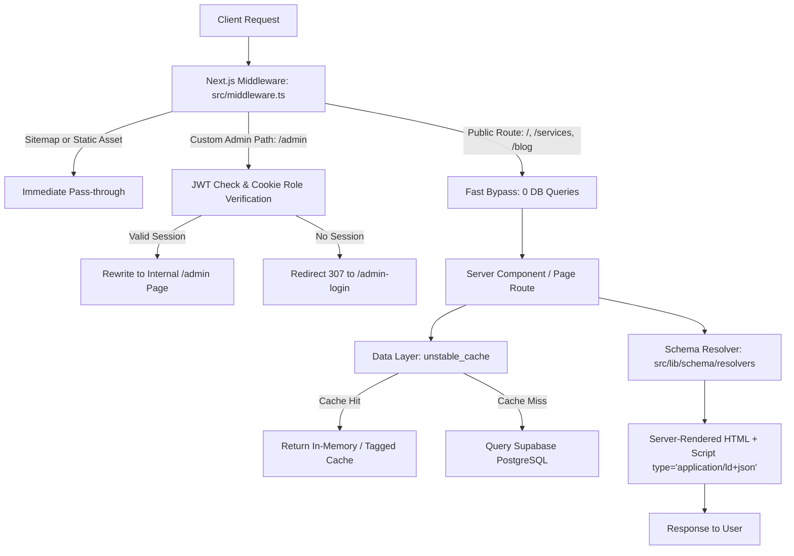

# Mommantum Project: Architecture & System Overview

> **Version:** 2.0.0  
> **Target Framework:** Next.js 15.3.9 (App Router) + React 19 + TypeScript 5  
> **Database & Backend:** Supabase (PostgreSQL 15 + RLS + GoTrue Auth) + Medusa V2 Proxy Architecture  
> **Styling & Design System:** Tailwind CSS + Radix UI + Motion  
> **Status:** Production Deployed (`https://mommantum-main.vercel.app`)

---

## 1. Executive Summary & Purpose

**Mommantum** is a hybrid digital platform engineered for high-growth Direct-to-Consumer (D2C) brands, combining:
1. **Agency Service & Consulting Storefront:** 16 specialized agency offerings (Performance Marketing, SEO/GEO/AEO, AI Automation, Web/App Development, Branding, Copywriting, Video Production).
2. **Editz Video Production Division:** Dedicated sub-brand showcasing short-form video editing, motion graphics, podcast production, and AI video pipelines.
3. **Case Study & Work Portfolio:** Interactive case studies detailing measurable ROI, conversion metrics, and client deliverables.
4. **Editorial & AI Thought Leadership Blog:** Long-form technical and strategic articles with automated schema markup and n8n ingestion.
5. **Simulated Medusa E-Commerce Storefront:** Full cart, checkout, region selection, and product fulfillment pipeline running seamlessly on Supabase.
6. **Unified Enterprise Schema & Dynamic SEO Engine:** Automated JSON-LD linked data graph, Google Indexing API push notifications, automated sitemaps, and strict meta resolver pipelines.
7. **Custom Administrative Suite:** Protected `/admin` interface managing Services, Case Studies, Blogs, SEO Settings, E-Commerce Products/Orders, and User Access Control.

---

## 2. Directory & Component Structure

```
mommantum-main/
├── .agents/                        # Antigravity agent configuration, rules, and skills
│   ├── AGENTS.md                   # Strict guidelines (English-only, schema preservation)
│   └── skills/                     # Workspace specialized agent skills
│       ├── frontend-performance/   # TTFB, layout shift, and image delivery guidelines
│       ├── internal-linking/       # AI link suggestions and vector graph guidelines
│       ├── schema/                 # JSON-LD graph construction & Google Rich Results rules
│       ├── project-architecture/   # Comprehensive architecture blueprint
│       ├── security-hardening/     # Security policies, RLS, auth verification
│       └── sds-authoring/          # Software Design Specification standards
├── db-proposals/                   # Reviewable SQL migration scripts & seeds (unexecuted on prod)
├── public/                         # Static assets directly served by Next.js
│   ├── images/                     # Case studies, testimonials, and static UI assets
│   └── og/                         # Pre-rendered 1200x630 OpenGraph share images
│       ├── pages/                  # Static page share images (11 files)
│       └── services/               # Service-specific share images (16 files)
├── src/
│   ├── app/                        # Next.js 15 App Router directory
│   │   ├── (checkout)/             # Checkout flow with isolated layout
│   │   ├── (store)/                # Public marketing storefront & ecommerce
│   │   │   ├── about/              # About Mommantum page
│   │   │   ├── blog/               # Blog index and dynamic [slug] posts
│   │   │   ├── blog-ai/            # AI-specific blog index
│   │   │   ├── contact/            # Contact & onboarding lead forms
│   │   │   ├── editz/              # Dedicated video services landing page
│   │   │   ├── faq/                # Global FAQ directory
│   │   │   ├── privacy-policy/     # Legal privacy policy
│   │   │   ├── services/           # Services catalog and dynamic [slug] details
│   │   │   ├── terms-and-conditions/# Legal terms & conditions
│   │   │   └── work/               # Case studies index and dynamic [slug] details
│   │   ├── admin/                  # Administrative management dashboard
│   │   ├── admin-login/            # Dedicated admin authentication login page
│   │   ├── api/                    # Serverless API Route Handlers
│   │   │   ├── admin/              # RBAC-guarded administrative endpoints
│   │   │   ├── auth/               # Login, session callback, and logout handlers
│   │   │   ├── blog/               # Ingestion endpoints (e.g. n8n webhook)
│   │   │   ├── cron/               # Scheduled tasks (SEO auto-fill, keep-alive)
│   │   │   └── store/              # Medusa-compatible storefront proxy
│   │   ├── opengraph-image.jpg     # Root fallback OG image (1200x630)
│   │   ├── twitter-image.jpg       # Root fallback Twitter card image (1200x630)
│   │   ├── layout.tsx              # Root HTML shell & JSON-LD mounting point
│   │   ├── middleware.ts           # Edge request interceptor (routing & RBAC)
│   │   └── robots.ts & sitemap/    # Dynamic robots and chunked XML sitemaps
│   ├── lib/
│   │   ├── config/                 # Static configuration & RBAC role matrices
│   │   ├── data/                   # Data-fetching layer with ISR & unstable_cache
│   │   ├── schema/                 # Unified Enterprise JSON-LD Graph Engine
│   │   │   ├── resolvers/          # Type-safe entity resolvers (Page, Service, Blog, etc.)
│   │   │   ├── templates/          # Standard Schema.org node builders
│   │   │   ├── generate-graph.ts   # Connected @graph orchestrator
│   │   │   └── serialize.ts        # Safe XSS-escaped JSON-LD serializer
│   │   ├── services/               # AI generation, indexing, and background services
│   │   ├── auth-helpers.ts         # User session verification & role enforcement
│   │   └── supabase-admin.ts       # Supabase service-role client instance
│   └── modules/                    # Domain-driven UI feature modules
│       ├── common/components/      # JsonLd, Headings, Modals, Buttons
│       ├── layout/                 # Global Navigation, Footer, Mobile Drawer
│       └── home/components/        # Hero, Metrics, Service Carousel, FAQ Accordion
```

---

## 3. Core Functional Pillars

### 3.1. Routing & Request Lifecycle



1. **Zero-Blocking Public Middleware:** Requests to public storefront routes (`/`, `/services`, `/blog`, `/work`, etc.) bypass database checks immediately in `src/middleware.ts`, eliminating Time to First Byte (TTFB) latency.
2. **Administrative Obfuscation:** The middleware supports a configurable `CUSTOM_ADMIN_PATH` environment variable, masking `/admin` behind a custom URL slug and returning a 404 to unauthorized visitors.

---

### 3.2. Dynamic SEO & Unified Schema Architecture

Rather than injecting disconnected, arbitrary JSON-LD tags on individual components, Mommantum operates on a **Single-Graph Architecture**:

1. **Central Schema Registry:** Every route executes a typed data resolver (e.g. `resolveServiceData`, `resolveBlogData`, `resolveAboutData`).
2. **Dual-Use Contract:** The same resolver output powers:
   - Next.js `generateMetadata()` (OpenGraph, Twitter cards, canonical URLs, robots meta).
   - JSON-LD `@graph` generation via `<JsonLd type="..." data={...} />`.
3. **Connected Entities:** Top-level nodes (`WebSite`, `Organization`, `WebPage`, `BreadcrumbList`, `FAQPage`) are linked by authoritative `@id` URIs (e.g., `https://www.mommantum.com/#organization`).
4. **Real Data Integrity:** The schema strictly reflects visible content. If a service lists 10 visible FAQs in its database record, exactly those 10 FAQs are mirrored in the `FAQPage` node. No hidden or boilerplate FAQs are emitted.

---

### 3.3. Simulated Medusa E-Commerce Engine

Mommantum includes full e-commerce support without requiring a standalone Node.js Medusa backend server:
* `src/app/api/store/[[...path]]/route.ts` acts as an in-process proxy simulating the Medusa Storefront API.
* Routes like `/api/store/products`, `/api/store/carts`, `/api/store/shipping-options`, and `/api/store/payment-collections` directly map to Supabase PostgreSQL tables (`product`, `product_variant`, `cart`, `cart_line_item`, `region`).
* Allows standard Medusa frontend SDK modules (`@medusajs/js-sdk`) to operate seamlessly inside Next.js Server Components and Client Components.

---

### 3.4. Background Ingestion & Automation Pipelines

* **n8n Automated Workflow (`mommantum_supabase.json`):** External workflow that monitors Google Sheets for target SEO keywords, invokes Google Gemini / OpenAI to draft structured articles, formats FAQs and image links, and publishes directly into the `post` table.
* **Google Indexing API Notification (`src/lib/services/indexer.ts`):** Automatically notifies Google Search Console of published or updated URLs using Google Service Account credentials (`GOOGLE_CLIENT_EMAIL`, `GOOGLE_PRIVATE_KEY`).
* **AI SEO Auto-Fill Service (`src/lib/services/ai-seo-service.ts`):** Analyzes products and content, scrapes real search queries via AnswerThePublic / RapidAPI, and writes optimized titles, descriptions, and FAQs to `seo_setting`.

---

## 4. Current Configuration Matrix

| Resource | Value / Source | Description |
| :--- | :--- | :--- |
| **Site Base URL** | `https://www.mommantum.com` | Production canonical root |
| **Active Supabase URL** | `https://zuwgqlwrkhmlmcvaqxyl.supabase.co` | Live PostgreSQL & Auth backend |
| **Vercel Production** | `https://mommantum-main.vercel.app` | Active Vercel serverless deployment |
| **Primary Currency** | `INR (₹)` | Default D2C currency configuration |
| **Language Target** | `en-IN` | English (India) localization in metadata |
