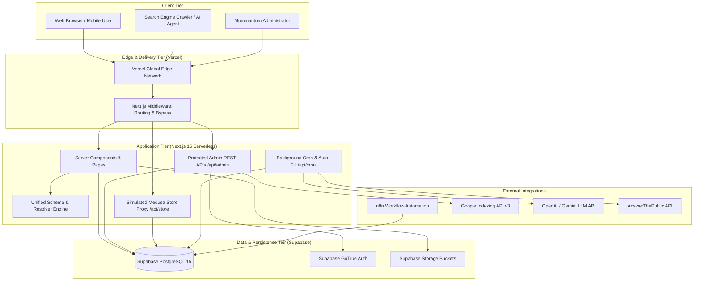
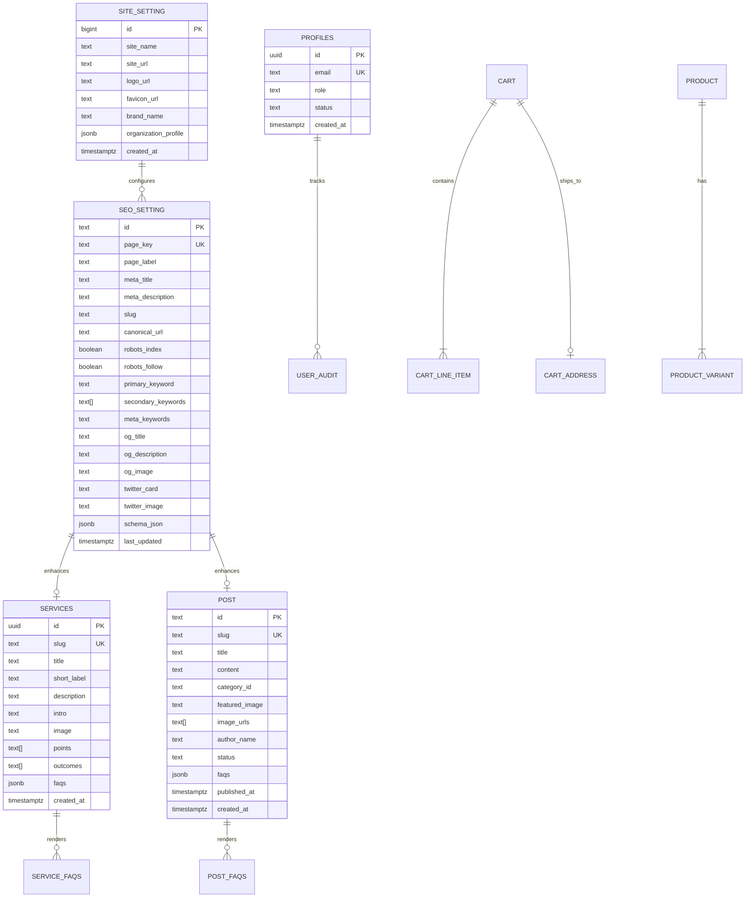
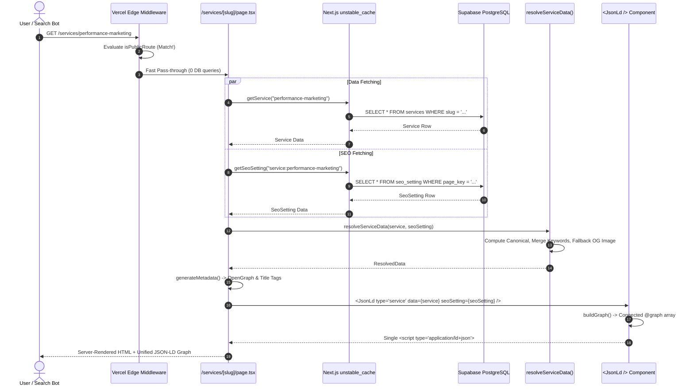

# Software Design Specification (SDS): Mommantum Studio & Storefront

> **Document Version:** 2.1.0  
> **Classification:** Technical Architecture & System Design Specification  
> **Status:** Active / Production Baseline  
> **Author:** Architecture Engineering Team  

---

## 1. System Scope & Engineering Objectives

The **Mommantum System** is designed to satisfy three high-performance engineering requirements:
1. **Ultra-Low Latency Public Experience:** Sub-200ms TTFB for all marketing and portfolio pages through edge bypass, static generation (SSG/ISR), and memory-cached database queries.
2. **Unified Semantic Graph (SEO & GEO):** 100% Schema.org compliant, single-script connected graph structure for search engines (Google Rich Results) and Generative AI engines (AEO/GEO).
3. **Serverless Full-Stack Resilience:** Fully decoupled front-end and back-end pipelines leveraging Next.js 15 App Router on Vercel and PostgreSQL with Row Level Security on Supabase.

---

## 2. High-Level Architecture (C4 Level 2: Container Diagram)



---

## 3. Component Architecture & Design Patterns

### 3.1. The Resolver-Registry-Graph Pattern

To eliminate schema duplication and drift between visible HTML and metadata, the system implements a strict functional pipeline:

```
[Database Content Rows] + [seo_setting Record]
                  │
                  ▼
         [Entity Resolver]  (e.g., resolveServiceData)
                  │
      ┌───────────┴───────────┐
      ▼                       ▼
[generateMetadata]     [buildGraph]
(OG/Twitter/Meta)             │
                              ▼
                     [Single Graph Tree]
                              │
                              ▼
                     [serializeJsonLd] (XSS-Safe HTML)
                              │
                              ▼
               <script type="application/ld+json">
```

#### Core Components in `src/lib/schema/`:
* `resolvers/`: Pure functional transformers that accept domain models (e.g. `Service`, `BlogPost`) and database `SeoSetting` records, producing a normalized `ResolvedData` object.
* `templates/`: Schema.org builder functions (`createWebSiteSchema`, `createOrganizationSchema`, `createWebPageSchema`, `createBreadcrumbSchema`, `createFAQSchema`).
* `generate-graph.ts`: Assembles disparate entity nodes into an integrated `@graph` array connected via deterministic `@id` URIs.
* `serialize.ts`: Ensures safe JSON serialization by escaping script termination characters (`<`, `>`, `&`).
* `src/modules/common/components/json-ld/index.tsx`: Server Component rendering the single `<script type="application/ld+json">`.

---

## 4. Database Entity-Relationship (ER) Schema



---

## 5. End-to-End Sequence Flows

### 5.1. Public Service Page Request with Dynamic Schema Resolution



---

## 6. Multi-Tier Caching Architecture

| Level | Storage Mechanism | TTL | Cache Tags | Invalidation Strategy |
| :--- | :--- | :--- | :--- | :--- |
| **L1: Edge Role Cache** | `Map<string, RoleSession>` in `globalThis` | 15 mins | — | Token expiration or cookie removal |
| **L2: Process Memory Cache** | `inMemorySeoCache` in `src/lib/data/seo.ts` | 5 mins | — | Explicit route invalidation call |
| **L3: Next.js Data Cache** | Vercel Serverless Cache (`unstable_cache`) | 1 hour | `site_setting`, `seo_setting` | `revalidateTag("seo_setting")` |
| **L4: Static Page Revalidation** | Next.js Incremental Static Regeneration | 60–300s | Page routes | Triggered on admin edit or n8n publish |

---

## 7. Performance & Optimization Metrics

1. **Zero Layout Shift (CLS < 0.05):** Strict dimension reservation on all responsive images with explicit aspect ratios and Tailwind container widths.
2. **First Contentful Paint (FCP < 0.9s):** Google Fonts (`Epilogue`, `Outfit`, `Inter`) preloaded and optimized using Next.js Font Subsetting.
3. **Standard Share Image Dimensions:** All social previews standardized at **1200 x 630 pixels**, matching Facebook, LinkedIn, Twitter/X, and WhatsApp OpenGraph standards.
