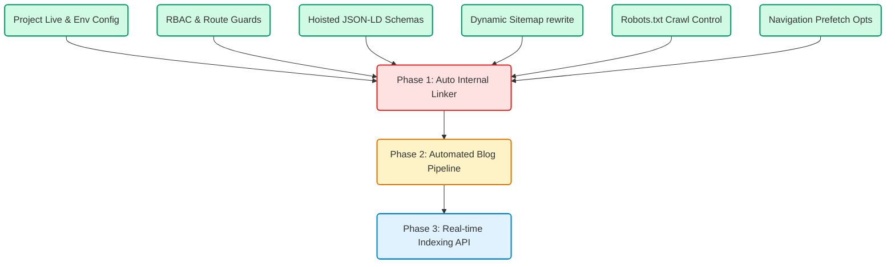

# System Design Specification (SDS) - Mommantum Growth Platform

This document serves as the comprehensive System Design Specification (SDS) for the Mommantum storefront platform. It covers the current completed architecture and outlines a phased, technical blueprint for future features: automated internal linking, blog generation automation, and search engine optimization automation.

---

## 1. Completed Components (Current Architecture)

### 1.1 Project Live & Deployment Setup
The Mommantum application is built on **Next.js (App Router)** and deployed to **Vercel** with a clean integration to a **Supabase database** and **Medusa engine storefront**.
* **Base URL Resolution:** A centralized helper dynamically extracts the correct domain:
  ```typescript
  export const getBaseURL = () => {
    return process.env.NEXT_PUBLIC_BASE_URL || "https://mommantum.com"
  }
  ```
* **Routing Cleanliness:** The dynamic country code parameter prefix (e.g., `/in`) has been removed from all URLs. The site routing operates natively at the root (e.g. `/`, `/about`, `/services`), with data-fetching parameters default-configured to `"in"` (India) under the hood.

### 1.2 Role-Based Access Control (RBAC)
To protect administrative actions, client information, and backend endpoints:
* **Supabase Integration:** Next.js middleware coordinates with Supabase Auth to validate user sessions using the `sb-access-token` cookie.
* **Edge Cache:** Authorized administrator sessions are cached in-memory at the edge for 10 minutes to minimize Supabase connection overhead.
* **Access Control Lists:** Routes under `/admin` require validation against a permissions profile map in `src/lib/config/roles.ts`. Unapproved or non-admin roles are redirected to `/admin-login` with context-specific error prompts.

### 1.3 Client-Hoisted SEO Schema
Structured schema markup is vital for search engine visibility. We implemented a dynamic hoisting component:
* **Component:** `src/modules/common/components/hoisted-schema/index.tsx`
* **Mechanism:** Rendered in raw HTML (for SSR crawlers), it injects a `<script type="application/ld+json">` tag directly into the body. On client-side mount, it programmatically pushes this element into the `<head>` to maintain document hierarchy while ensuring compatibility with Google's Rich Results tester.
* **Configured Schemas:** Dynamically hydrated graphs for `Organization`, `BreadcrumbList`, `Article`, `Service`, and `Product`.

### 1.4 Consolidated Dynamic Sitemap Index
The separate `sitemap` and `sitemap.xml` dynamic routes are consolidated into `src/app/sitemap/`:
* **Index Route:** `src/app/sitemap/route.ts` generates a dynamic `<sitemapindex>` listing sub-sitemap files:
  - `/sitemap/pages.xml` (static storefront pages)
  - `/sitemap/services.xml` (services loaded from Supabase)
  - `/sitemap/work.xml` (case studies)
  - `/sitemap/products.xml` (products list)
  - `/sitemap/collections.xml` (collections list)
  - `/sitemap/blogs.xml` (blog posts)
* **Next.js Rewrite:** Pointing standard crawler requests from `/sitemap.xml` directly to the `/sitemap` handler via `next.config.js`:
  ```javascript
  async rewrites() {
    return [{ source: "/sitemap.xml", destination: "/sitemap" }]
  }
  ```

### 1.5 Robots.txt
* **Configuration:** Located at `src/app/robots.ts`.
* **Exclusions:** Disallows bots from crawling personal, sensitive, or redundant checkout pages (`/checkout`, `/cart`, `/account`, `/wishlist`, `/api`, `/admin`).
* **Bot Guard:** Explicitly blocks aggressive scrapers and competitive analysis tools (e.g., AhrefsBot, SemrushBot) to reduce server resource drain.

### 1.6 Prefetch & Loading Performance
* **Prefetch Mitigation:** dropdown links and mobile drawer links use `prefetch={false}` to avoid choking the browser's initial resource pipeline with parallel requests to hidden routes.
* **Server-Side Caching:** Key queries (regions, collections, blog details) utilize cached fetches with Next.js revalidation settings.

---

## 2. Future Phased Implementation Plan



---

### Phase 1: Automated Internal Linking Engine

#### Purpose
Increase search engine authority (domain authority and PageRank) by automatically hyperlinking keywords in blogs and services to relevant service pages, case studies, or product listings.

#### Architectural Specification
Rather than manually editing post bodies, a server-side **hydrator** intercepts the HTML content before rendering, matches defined keywords, and injects links dynamically.

1. **Database Schema Setup (`site_keywords`):**
   ```sql
   CREATE TABLE site_keywords (
     id UUID PRIMARY KEY DEFAULT gen_random_uuid(),
     keyword VARCHAR(100) UNIQUE NOT NULL,
     target_url VARCHAR(255) NOT NULL,
     max_matches_per_page INT DEFAULT 1,
     created_at TIMESTAMP WITH TIME ZONE DEFAULT NOW()
   );
   ```

2. **Regex Parser and HTML Injector Helper (`src/lib/util/linker.ts`):**
   ```typescript
   export function injectInternalLinks(htmlContent: string, keywords: { keyword: string, url: string, max: number }[]): string {
     let hydratedContent = htmlContent;
     
     // Order keywords by length descending to prevent shorter words breaking subwords
     const sortedKeywords = [...keywords].sort((a, b) => b.keyword.length - a.keyword.length);
     
     for (const item of sortedKeywords) {
       // Matches keyword case-insensitively, ensuring it is not already inside an anchor tag (<a ...>keyword</a>) or HTML attribute
       const regex = new RegExp(`(?<!<a[^>]*>)\\b(${item.keyword})\\b(?![^<]*</a>)`, 'gi');
       
       let matchCount = 0;
       hydratedContent = hydratedContent.replace(regex, (match) => {
         if (matchCount < item.max) {
           matchCount++;
           return `<a href="${item.url}" class="internal-link text-[#e61e73] font-semibold hover:underline">${match}</a>`;
         }
         return match;
       });
     }
     
     return hydratedContent;
   }
   ```

3. **Hydration Integration:**
   Update `src/app/(store)/blog/[slug]/page.tsx` and `src/app/(store)/services/[slug]/page.tsx` to pull keywords from Supabase and run `injectInternalLinks` on the content before passing it to `dangerouslySetInnerHTML`.

---

### Phase 2: Automated Blog Generation & Publishing Pipeline

#### Purpose
Consistently publish SEO-optimized blogs without developer intervention. AI generates content, extracts keywords, maps metadata, and uploads drafts straight to Supabase.

#### Architectural Specification

1. **Supabase Schema Additions (`blog_posts` table validation):**
   ```sql
   ALTER TABLE blog_posts 
   ADD COLUMN IF NOT EXISTS status VARCHAR(20) DEFAULT 'draft' CHECK (status IN ('draft', 'published')),
   ADD COLUMN IF NOT EXISTS meta_title VARCHAR(150),
   ADD COLUMN IF NOT EXISTS meta_description VARCHAR(250),
   ADD COLUMN IF NOT EXISTS excerpt TEXT;
   ```

2. **Automation Pipeline Hook (`src/app/api/blog/publish/route.ts`):**
   An API endpoint protected by API Key authentication to receive generated blogs from external workflows (e.g. n8n, make.com, or a scheduled cron subagent).
   ```typescript
   import { NextResponse } from "next/server"
   import { createClient } from "@supabase/supabase-js"
   import { z } from "zod"

   const blogPayloadSchema = z.object({
     title: z.string().min(3),
     content: z.string().min(50),
     category_id: z.string().optional(),
     meta_title: z.string().max(60).optional(),
     meta_description: z.string().max(160).optional(),
     excerpt: z.string().max(200).optional(),
     featured_image: z.string().url().optional(),
   })

   export async function POST(req: Request) {
     try {
       const authHeader = req.headers.get("authorization")
       if (authHeader !== `Bearer ${process.env.AUTOMATION_SECRET_KEY}`) {
         return NextResponse.json({ error: "Unauthorized" }, { status: 401 })
       }

       const body = await req.json()
       const parsed = blogPayloadSchema.parse(body)
       const slug = parsed.title.toLowerCase().replace(/[^a-z0-9]+/g, "-").replace(/(^-|-$)+/g, "")

       const supabase = createClient(
         process.env.NEXT_PUBLIC_SUPABASE_URL!,
         process.env.SUPABASE_SERVICE_ROLE_KEY!
       )

       const { data, error } = await supabase.from("blog_posts").insert({
         title: parsed.title,
         slug,
         content: parsed.content,
         category_id: parsed.category_id || "Marketing",
         meta_title: parsed.meta_title || parsed.title,
         meta_description: parsed.meta_description || parsed.excerpt,
         excerpt: parsed.excerpt,
         featured_image: parsed.featured_image,
         status: "published",
         published_at: new Date().toISOString()
       }).select().single()

       if (error) throw error

       return NextResponse.json({ success: true, post: data })
     } catch (err: any) {
       return NextResponse.json({ error: err.message }, { status: 400 })
     }
   }
   ```

---

### Phase 3: SEO Automation & Real-time Indexing

#### Purpose
Notify crawlers instantly when posts or services are added, verify Schema sanity automatically, and track keyword rankings on search result pages.

#### Architectural Specification

1. **Google Indexing API and IndexNow Client (`src/lib/services/indexer.ts`):**
   Allows programmatic submission of updated URLs directly to Google and Bing for rapid indexing.
   ```typescript
   import { google } from "googleapis"

   export async function notifyGoogleOfUpdate(url: string, type: "URL_UPDATED" | "URL_DELETED") {
     const jwtClient = new google.auth.JWT(
       process.env.GOOGLE_CLIENT_EMAIL,
       undefined,
       process.env.GOOGLE_PRIVATE_KEY?.replace(/\\n/g, "\n"),
       ["https://www.googleapis.com/auth/indexing"]
     )

     await jwtClient.authorize()

     const response = await google.indexing("v3").urlNotifications.publish({
       auth: jwtClient,
       requestBody: {
         url,
         type,
       },
     })

     return response.data
   }
   ```

2. **Trigger Hooks on CRUD Actions:**
   Call `notifyGoogleOfUpdate` instantly inside:
   - Supabase DB Webhooks on inserts to `blog_posts` or `services` tables.
   - Vercel server actions after creating or modifying site pages.
